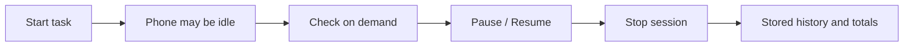

# TTApp — Time Tracker App

**An offline-first Android stopwatch with a memory.**

TTApp records **when** work starts, pauses, resumes, and stops—not a stream of ticking seconds. Start an activity, put your phone away, return hours later, and check your accumulated time without needing a continuously running background timer.

> **Start working → Forget the app → Check elapsed time on demand → Pause or stop → Keep the history.**

**Project status:** See the [validation checklist](docs/TESTING_AND_LIMITATIONS.md) for build results and remaining Galaxy S23 checks.

## Why TTApp?

A regular stopwatch measures time but forgets what it was for. A task manager remembers work but demands organization, deadlines and statuses. TTApp provides the useful middle ground: reusable activities with session histories and reliable timestamp-based accumulation.

The app deliberately has no mandatory projects, labels, priorities, completion states, accounts, servers, or online sync.

## Core experience

1. Open **Stopwatch**, enter a title and optionally a description.
2. Press **Start** and leave the app. Timing is reconstructed from persisted timestamps.
3. Tap **Check Time** to reveal the current session duration in `HH:MM:SS` for approximately three seconds.
4. **Pause** without losing the session, **Resume** when ready, or **Stop** to end only that session.
5. Open **Home** to search activities, reuse any task, view lifetime totals and inspect history.
6. Organize work into projects or labels **later**, only if you want to.



## Features currently represented in source

| Area | Implementation |
| --- | --- |
| Time engine | Wall-clock + monotonic elapsed-time anchors, atomic Room transitions, one running task at a time |
| Interface | Native Jetpack Compose, Material 3, dark carbon/cyan design, Stopwatch and Home tabs |
| Tasks | Reusable title/description, lifetime totals, local search |
| History | Sessions, intervals, notes, manual corrections/deletions |
| Organization | Optional projects and labels; retroactive assignment |
| Insights | Daily/weekly totals, per-task and per-project summaries |
| Portability | Local CSV export; JSON backup and confirmed restore |
| System integration | Home-screen widget and optional event-driven notifications with actions |
| Tests | JVM timekeeping and calendar tests, plus Android repository and backup tests |

The tracker is designed to **avoid ongoing CPU work** while a session is running. UI time snapshots and system surfaces update only when needed, not on a one-second timer.

## Visual identity

The default appearance is dark carbon (`#101417`) with subtle graphite cards (`#1C2429`) and controlled cyan accents (`#00D9E8`). Buttons are rounded and lightweight; glass-like styling is restrained rather than implemented with expensive live blur. The goal is a calm, distraction-free experience.

## Documentation

Detailed documents for contributors and future development agents live in [`docs/`](docs/README.md):

| Read | For |
| --- | --- |
| [Product Vision](docs/PRODUCT_VISION.md) | Purpose, non-negotiable principles, scope and non-goals |
| [User Flows](docs/USER_FLOWS.md) | Start/pause/resume/stop, task reuse, history, backup, widgets |
| [Design System](docs/DESIGN_SYSTEM.md) | Colors, typography, navigation, layout and UX constraints |
| [Architecture](docs/ARCHITECTURE.md) | Room entities, repository, time math, clock/reboot behavior |
| [Development Roadmap](docs/DEVELOPMENT_ROADMAP.md) | Phase-by-phase commits, remaining priorities, change rules |
| [Testing & Limitations](docs/TESTING_AND_LIMITATIONS.md) | Acceptance matrix, build blockers, Samsung/AOD realities |

## Tech stack and repository layout

**Kotlin · Jetpack Compose · Material 3 · Room/SQLite · Coroutines/Flow · Android Widget/Notification APIs · Gradle**

```text
TTApp/
├── README.md                    # Project overview (this file)
├── docs/                        # Product, UX and engineering documentation
├── app/
│   ├── build.gradle.kts
│   └── src/
│       ├── main/
│       │   ├── java/com/ttapp/
│       │   │   ├── MainActivity.kt
│       │   │   ├── HistoryScreen.kt
│       │   │   ├── TTApplication.kt
│       │   │   ├── data/        # Room, repository, backup
│       │   │   ├── domain/      # Time math
│       │   │   ├── integration/ # Widgets and notifications
│       │   │   └── ui/          # Theme, organization, insights
│       │   └── res/             # Android layouts, values, widget assets
│       └── test/                # Unit test sources
├── gradle/wrapper/
├── gradlew.bat
└── settings.gradle.kts
```

## Building on Windows

Prerequisites: **JDK 17 or newer**, **Android SDK Platform 36**, **Android SDK Build Tools 36.0.0**, and access to Google Maven / Gradle artifact repositories. Gradle **8.13** is configured through the included wrapper.

Open Android Studio's **SDK Manager** and install the SDK components after reviewing and accepting the SDK license. From PowerShell:

```powershell
cd C:\Users\ASUS\Documents\Code\TTApp
$env:JAVA_HOME = 'C:\path	o\jdk-21'
.\gradlew.bat :app:testDebugUnitTest
.\gradlew.bat :app:assembleDebug
```

The debug-signed APK is written to `app/build/outputs/apk/debug/app-debug.apk`. Transfer it to the phone and open it to install. Android may ask you to allow installs from the app used to open the file.

## Samsung S23 and Always-On Display

The target is a Samsung Galaxy S23 / One UI device. Native interactive modification of Samsung's AOD is **not assumed possible** using ordinary public Android APIs. The source implements supported-style notification and `RemoteViews` widget shortcuts as the nearest practical alternatives. Their real lock-screen/AOD visibility and interaction behavior depend on Android/One UI version, permissions, privacy settings and device testing.

## Timing accuracy and data safety

- Within a boot, duration uses Android's monotonic elapsed-time clock, not user-editable wall time.
- After reboot, a wall-clock fallback may include powered-off time and may be affected by manual clock changes.
- Tasks and intervals live in a private Room database; automatic cloud backup is disabled.
- CSV and JSON exports are **user-selected files**. JSON restore replaces existing local task data after confirmation and restores an active snapshot as paused.
- Future Room schema changes require deliberate migrations. Don't discard stored histories.

## Development history

The repository was created with a separate Git commit for each of seven phases. Review progress using:

```powershell
git log --oneline --reverse
git status
```

Before calling this app functional or production-ready: resolve build dependencies, compile, run tests, exercise all core flows, test the Samsung integrations, and measure idle battery/CPU behavior. The detailed checklist is in [Testing & Limitations](docs/TESTING_AND_LIMITATIONS.md).
