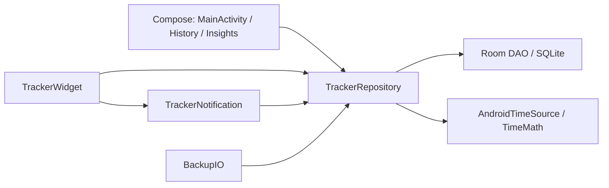
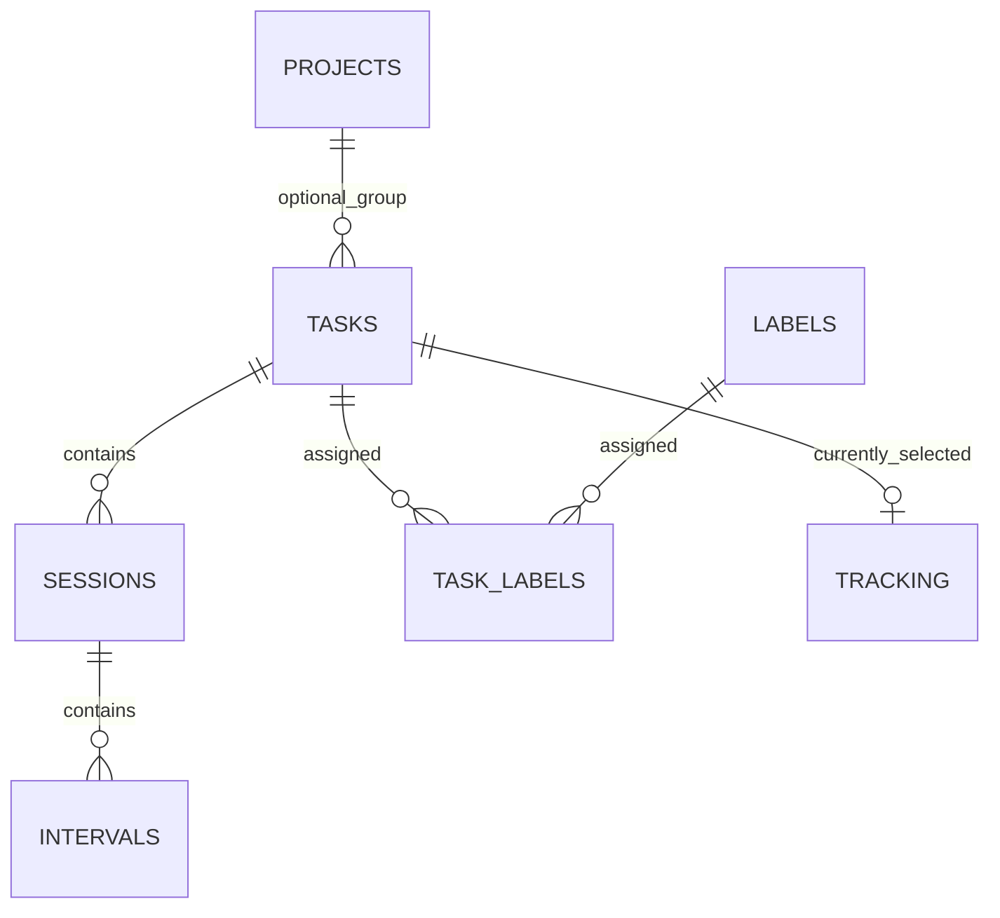

# System Architecture & Data Integrity

## Technology stack

- **Platform:** Native Android app, Kotlin.
- **UI:** Jetpack Compose with Material 3 and two-tab navigation.
- **Persistence:** Room over SQLite; local-only private app database.
- **Async:** Kotlin Coroutines, Room `Flow` for task/tracking change observation.
- **Integration:** `AppWidgetProvider` / `RemoteViews` and Android notification APIs.
- **Build:** Android Gradle Plugin, Gradle wrapper, Android SDK.
- **No backend:** No network account, server, cloud sync, or continuously running timer service.

## Component map



| Path | Responsibility |
| --- | --- |
| `TTApplication.kt` | Lazily creates the Room database and repository |
| `MainActivity.kt` | Main Stopwatch and Home interface; UI-triggered system sync |
| `HistoryScreen.kt` | Session inspection, notes and interval correction |
| `ui/Theme.kt` | Carbon/cyan colors and Material theme |
| `ui/InsightsScreen.kt` | Daily/weekly/per-task totals, CSV and backup actions |
| `ui/OrganizationPanel.kt` | Optional project and label assignment |
| `data/Models.kt` | Room entities, DAO and database definition |
| `data/TrackerRepository.kt` | Transactional start, pause, stop, task updates |
| `data/BackupIO.kt` | Versioned JSON backup and transactional restore |
| `domain/TimeMath.kt` | Monotonic/reboot-aware elapsed calculations and formatting |
| `integration/TrackerWidget.kt` | Event-driven widget display and commands |
| `integration/TrackerNotification.kt` | Optional current-task and elapsed notifications |

## Database model



- **projects** (`id, name, color`)
- **tasks** (`id, title, description, projectId?, createdAt, updatedAt`)
- **labels** (`id, name, color`) and **task_labels** association
- **sessions** (`id, taskId, startedAt, endedAt?, notes`)
- **intervals** (`id, taskId, sessionId, startedAt, endedAt, durationMs, notes`)
- **tracking** (singleton id=1; `taskId?, sessionId?, running, startWallMs, startElapsedMs, startBootId`)

Room schema version is currently **1**. Database migrations for future versions must be explicitly designed and tested.

## Clock algorithm

On **Start** or **Resume**, persist a wall-clock timestamp, `SystemClock.elapsedRealtime()`, and the Android boot count (or `-1` if inaccessible). On **Check**, use the same-boot monotonic difference when valid; otherwise fall back to a nonnegative wall-clock difference.

```text
if sameBoot and nowElapsed >= anchorElapsed:
    liveMs = nowElapsed - anchorElapsed
else:
    liveMs = max(0, nowWall - anchorWall)
sessionTotal = sum(saved interval.durationMs for session) + liveMs
taskTotal = sum(saved interval.durationMs for task) + liveMs
```

On **Pause** and **Stop**, write a measured interval and update the singleton state in one Room transaction. Pause retains the session; Stop finalizes it. Starting another task first persists the previous active interval, preventing two simultaneous active accumulators.

**Why not store a ticking count?** The app can be closed for hours without work; elapsed time is reconstructed from persisted anchors on demand.

## Reliability details and tradeoffs

- **Process death:** Because the anchor lives in Room, reopening the app can derive the elapsed duration.
- **Reboot:** Monotonic time resets; wall-clock fallback may count power-off time and can be inaccurate after a clock change.
- **Manual wall-clock edits:** Within one boot, monotonic duration remains accurate, but constructed wall endpoints may not align with a changed clock.
- **Timezone changes:** Durations do not depend on timezone; calendar-day attribution is local-time-based.
- **Atomicity:** Repository transitions use Room `withTransaction`; single tracking row provides one current accumulator.
- **Search:** The Home UI filters observed records locally. The schema does not currently include full-text-search indexes; benchmark before claiming scalability.
- **Live view updates:** The timer itself does not poll. Some UI snapshots occur when tabs/view state changes, not every second.
- **Backup:** A running interval is snapshotted for JSON export; restore replaces existing local data transactionally and makes restored active state paused.

## Integration boundaries

Notifications and widgets are convenience layers over the same repository. The code updates them on user events, not through scheduled 1-second refreshes. Do not implement a custom always-on overlay or foreground service solely to display time.

**Build status:** Source-level architecture is present, but compilation and automated/device tests remain blocked/unverified (see [Testing & Limitations](TESTING_AND_LIMITATIONS.md)).
