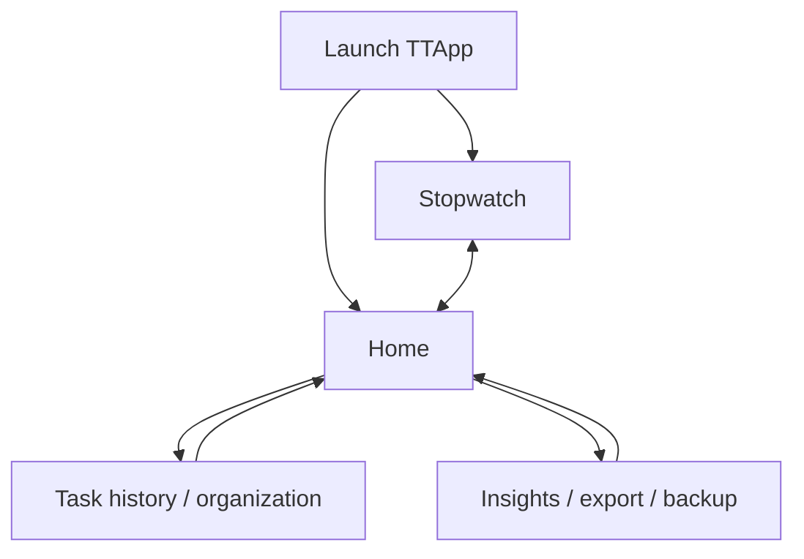
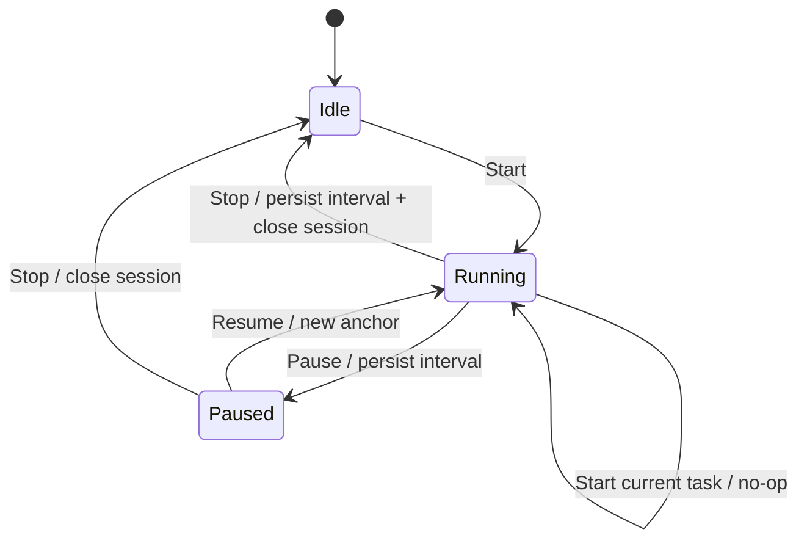

# User Flows & Interaction Contracts

## Navigation

Only **Stopwatch** and **Home** are primary tabs. Secondary screens are contextual; the first screen should never be an analytics dashboard or project picker.

## Flow 1 — First task

1. Open **Stopwatch**.
2. Type a task title. Add a description only if useful.
3. Tap **Start**. The app creates a reusable task and a session, records wall-clock time and a monotonic anchor, then becomes idle.
4. Leave the app or lock the device; no live stopwatch refresh is necessary.
5. Return and tap **Check Time**. The current session duration is computed on demand and shown in `HH:MM:SS`, normally for about three seconds.
6. Tap **Pause**, **Resume**, or **Stop session**.

**Invariant:** No project, label, deadline or completed status is required.

## Flow 2 — Pause vs. Stop

- **Pause** closes the accumulating interval and leaves the current session open.
- **Resume** begins a new interval in that same open session.
- **Stop** closes the current session and clears the active tracking anchor. It **does not** delete or complete the task.
- **Restart a stopped task** creates another session contributing to its lifetime total.
- **Start a different task** closes the previously running interval, switches the one active anchor, and opens or reuses a session for the new task. The previous task's session may remain open as paused in the current data model; review this behavior if changing switch semantics.

### Duration interpretation

- **Check Time:** Current open session's saved intervals + any currently running interval.
- **Home total:** Sum of the task's saved intervals across sessions, with a one-time snapshot of the active interval where displayed.
- **Session history:** Saved intervals; an unfinished live interval is not yet a persisted interval until transition.
- **Insights:** A snapshot of recorded intervals, plus a one-time approximation for a currently running interval when the view enters. No continuously ticking statistic.

## Flow 3 — Find and reuse an activity

1. Open **Home**.
2. Search a title, description, optional project or label.
3. Tap a task row to return to **Stopwatch** with that reusable activity.
4. Start timing it again or edit the title/description.
5. Tap its history icon to inspect sessions, interval corrections and optional organization.

A task's existence is independent of whether it has an active session.

## Flow 4 — Session review / correction

1. From **Home**, tap a task's history icon.
2. Expand a session; inspect its start/end information and saved interval durations.
3. Add or edit a session note; optionally correct interval start/end time or remove an interval/session.
4. Recomputed task and session totals should follow from interval data.

Choose local dates and times for the start and end of an interval. Save is available when the end is at or after the start.

## Flow 5 — Optional organization after the fact

Open a task's history view. Create/assign a project or create/apply labels as needed. All such actions are voluntary and reversible; uncategorized tasks remain valid. Search also matches project and label names.

## Flow 6 — Analytics & portability

From Home, open **Insights**. Review total time today/this week, per task, per project and recent days. Export CSV for spreadsheet analysis; export a local JSON backup via Android's document picker.

For **Restore**, choose a JSON backup and confirm that existing local task data will be replaced. The backup format captures a snapshot of a running interval; the restored session is paused rather than silently accumulating while moving data to a new device. Further roundtrip tests are required.

## Flow 7 — Widget and lock-screen access

- Home-screen `RemoteViews` widget: current task title, start time/status, tap to open app; pause/resume, check and stop shortcuts when a task is selected.
- Optional notification: task title and start time/status; pause/resume, check and stop actions.
- **Check** computes duration on demand and posts a short-lived elapsed-time notification; no ticking chronometer.
- Display on Samsung AOD, lock screen, and interaction before unlock **depends on platform policies/settings**. Do not promise interactive AOD controls on the S23 without device validation.

## Reliability / edge cases

- App swipe-away or process death: persisted anchor remains; recompute on re-entry.
- Reboot: monotonic clock cannot span boots; use a wall-clock fallback and explain possible inaccuracy.
- Timezone edits: durations should follow monotonic clock within the same boot; date groupings follow local time.
- Wall-clock edit: in-boot duration unaffected; interval's represented wall endpoints may require manual review.
- Zero-duration pause or stop: avoid saving meaningless intervals.
- Rapid double-tap or switching tasks: persistence must serialize transitions.
- Background Android limits: no permanent background timer or refresh service.
